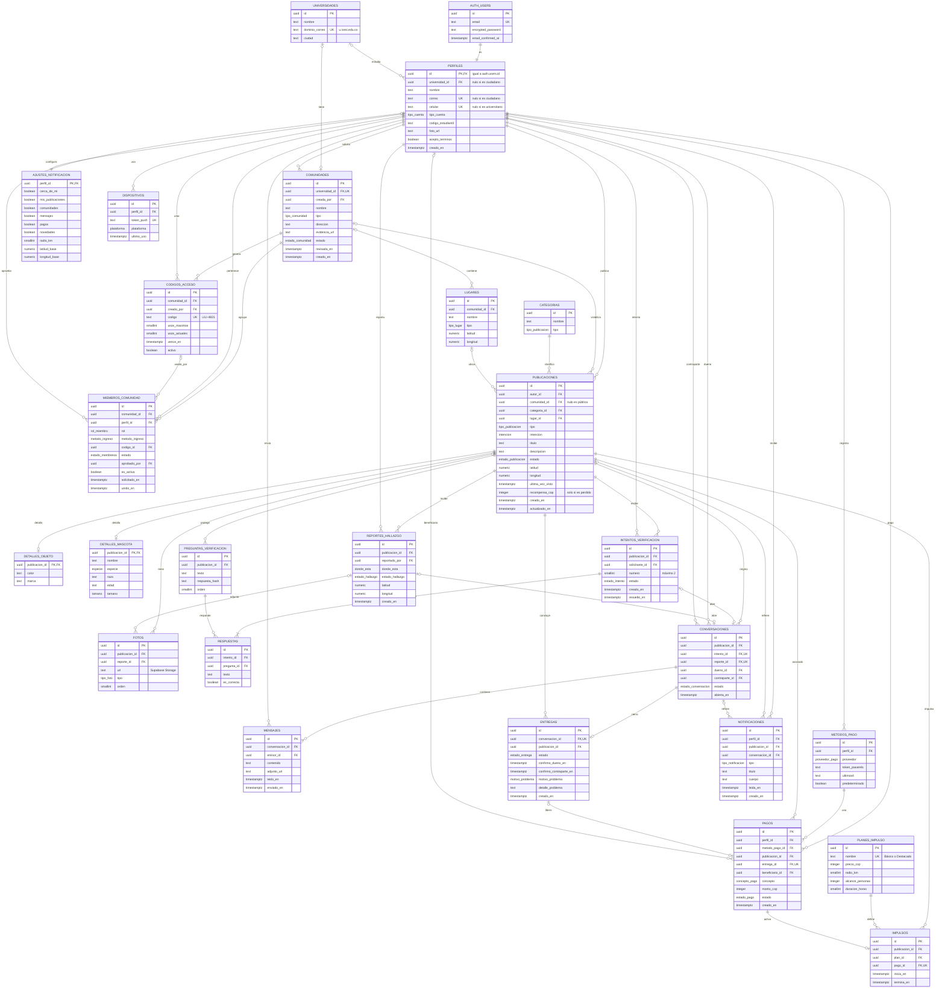

# Modelo de datos de FINDU

Base de datos relacional para **Supabase (PostgreSQL)**. Cubre todos los casos de uso del prototipo: cuentas de universitarios y ciudadanos de varias universidades, comunidades con administrador (código de acceso o aprobación), publicaciones de objetos y mascotas, verificación del dueño, reporte de hallazgo, chat, entrega con doble confirmación, impulsos, recompensas y avisos.

- **26 tablas** (25 propias + `auth.users` de Supabase Auth)
- **49 relaciones** (llaves foráneas)
- **24 tipos enumerados**

La versión visual, con colores por dominio, está en Figma, página **Flujo**, debajo del diagrama de flujo:
https://www.figma.com/design/FAhwhJ4rkuyxYau3C3WYDR/Findu-%E2%80%93-Redise%C3%B1o-App?node-id=92-219

## Diagrama entidad-relación

## Reglas del modelo

1. **Cuenta:** `perfiles.id` es el mismo id de `auth.users` (borrado en cascada). La contraseña solo vive en Supabase Auth.
2. **Tipo de cuenta:** el universitario usa el correo de una universidad registrada y su código estudiantil. El ciudadano usa celular. Siempre hay correo o celular.
3. **Varias universidades:** la universidad se elige o se detecta por `universidades.dominio_correo`. Cada universidad tiene su comunidad.
4. **Siempre hay admin:** al aprobarse una comunidad, su creador queda como miembro con rol `admin`. No puede salir el último admin.
5. **Ingreso a una comunidad:** solo con código de acceso o con aprobación de un admin. El correo institucional prueba la universidad, pero no da ingreso automático.
6. **Código de acceso:** es válido si está activo, no ha vencido y `usos_actuales < usos_maximos`. Al usarlo, el miembro queda aprobado y el código suma un uso.
7. **Solicitud de ingreso:** queda `pendiente` hasta que un admin la acepta o la rechaza. `aprobado_por` guarda quién decidió.
8. **Comunidad nueva:** queda `en_revision` hasta que el equipo FINDU aprueba la evidencia (acta, NIT o dominio).
9. **Comunidad activa:** cada perfil tiene una sola (índice único parcial sobre `perfil_id` donde `es_activa`).
10. **Detalle según tipo:** un objeto tiene `detalles_objeto` y una mascota tiene `detalles_mascota`, nunca los dos. La recompensa solo aplica si la intención es `perdido`.
11. **Preguntas privadas:** toda publicación `encontrado` tiene 3 preguntas. La respuesta se guarda como hash y nunca se muestra.
12. **Intentos:** máximo 2 por solicitante y publicación. Se aprueba solo con las 3 respuestas correctas.
13. **Abrir chat:** solo con un intento aprobado (algo encontrado) o con un reporte de hallazgo (algo perdido).
14. **Punto de encuentro:** no se guarda en ninguna tabla. Lo acuerdan los usuarios en los mensajes del chat.
15. **Doble confirmación:** la entrega queda `confirmada` cuando los dos marcan su confirmación. Entonces la publicación pasa a `entregada` y la recompensa pasa de `retenido` a `liberado`.
16. **Hubo un problema:** la entrega pasa a `con_problema` con su motivo. La publicación vuelve a `activa`, la recompensa sigue retenida y el chat sigue abierto.
17. **Impulso:** se activa cuando su pago se confirma. `termina_en = inicia_en + duracion_horas` del plan.
18. **Pagos seguros:** nunca se guardan números de tarjeta ni de cuenta, solo el token de la pasarela y los últimos 4 dígitos.
19. **Borrado:** borrar una publicación borra en cascada sus detalles, fotos, preguntas, intentos y notificaciones. Las conversaciones y los pagos se conservan como historial.
20. **Seguridad (RLS):** cada usuario solo lee y escribe sus filas (`auth.uid()`). Las publicaciones se leen si son públicas o de una comunidad donde es miembro aprobado.

## Datos que se calculan (no se guardan)

| Dato | Cómo se obtiene |
| --- | --- |
| Contadores del perfil (devueltos, publicados, perdidos) | Conteo de publicaciones del autor por estado e intención |
| Miembros de una comunidad | Conteo de `miembros_comunidad` aprobados |
| Usos restantes de un código | `usos_maximos − usos_actuales` |
| Distancia "a 300 m" | Distancia entre el usuario y la publicación (PostGIS o Haversine) |
| "Hace 1 h" | `now() − creado_en` o `ultima_vez_visto` |
| Intentos restantes | `2 −` intentos del solicitante en esa publicación |
| Vecinos alertados | Perfiles con alertas activas dentro del radio |
| Tiempo restante del impulso | `termina_en − now()` |
| No leídos | Notificaciones y mensajes con `leida_en` / `leido_en` nulo |
| "Laura ya confirmó" | `confirmo_dueno_en` y `confirmo_contraparte_en` de la entrega |

## Cobertura de casos de uso

| Pantallas (número en Figma) | Tablas |
| --- | --- |
| 01 Login · 02-04 Registro · 03 Elige tu universidad | `auth.users`, `perfiles`, `universidades` |
| 05-07 Recuperar contraseña | `auth.users` (Supabase Auth) |
| 08 Inicio · 09 Explorar · 10 Mapa · 19 Detalle | `publicaciones`, `categorias`, `fotos`, `lugares`, `detalles_objeto`, `detalles_mascota` |
| 13-15 Publicar objeto o mascota · 16 Compartir | `publicaciones`, detalles, `fotos`, `preguntas_verificacion`, `notificaciones` |
| 17-18 Impulsar | `planes_impulso`, `impulsos`, `pagos`, `metodos_pago` |
| 20-23 Verificación | `preguntas_verificacion`, `intentos_verificacion`, `respuestas` |
| 24 Encontré a… | `reportes_hallazgo`, `fotos` |
| 25-26 Chats y chat | `conversaciones`, `mensajes` |
| S1 Confirmar entrega · 27-29 Problema y entrega verificada | `entregas`, `pagos`, `publicaciones` |
| 30-35 Comunidades y panel admin | `comunidades`, `miembros_comunidad`, `codigos_acceso` |
| 11 Notificaciones · 12 Configurar alertas | `notificaciones`, `ajustes_notificacion`, `dispositivos` |
| 36 Perfil · 37 Métodos de pago | `perfiles`, `publicaciones`, `metodos_pago` |

## Tipos enumerados

| Tipo | Valores |
| --- | --- |
| `tipo_cuenta` | universitario, ciudadano |
| `tipo_comunidad` | educativa, residencial, corporativa, publica, evento |
| `estado_comunidad` | en_revision, activa, rechazada |
| `rol_miembro` | miembro, admin |
| `metodo_ingreso` | codigo, aprobacion, creador |
| `estado_membresia` | pendiente, aprobado, rechazado |
| `tipo_lugar` | campus, barrio |
| `tipo_publicacion` | objeto, mascota |
| `intencion` | perdido, encontrado |
| `estado_publicacion` | activa, en_verificacion, entregada, cerrada |
| `especie` | perro, gato, otro |
| `tamano` | pequeno, mediano, grande |
| `tipo_foto` | general, cara, cuerpo |
| `estado_intento` | pendiente, aprobado, rechazado |
| `donde_esta` | conmigo, veterinaria, porteria, otro |
| `estado_hallazgo` | buen_estado, asustado, herido, danado, otro |
| `estado_conversacion` | abierta, cerrada |
| `estado_entrega` | pendiente, confirmada, con_problema |
| `motivo_problema` | no_era, no_llego, sin_acuerdo, otro |
| `proveedor_pago` | nequi, tarjeta |
| `concepto_pago` | impulso, tarifa, recompensa |
| `estado_pago` | pendiente, retenido, liberado, reembolsado |
| `tipo_notificacion` | avistamiento, verificacion, cercana, mensaje, reencuentro, recompensa, comunidad, impulso |
| `plataforma` | ios, android |
